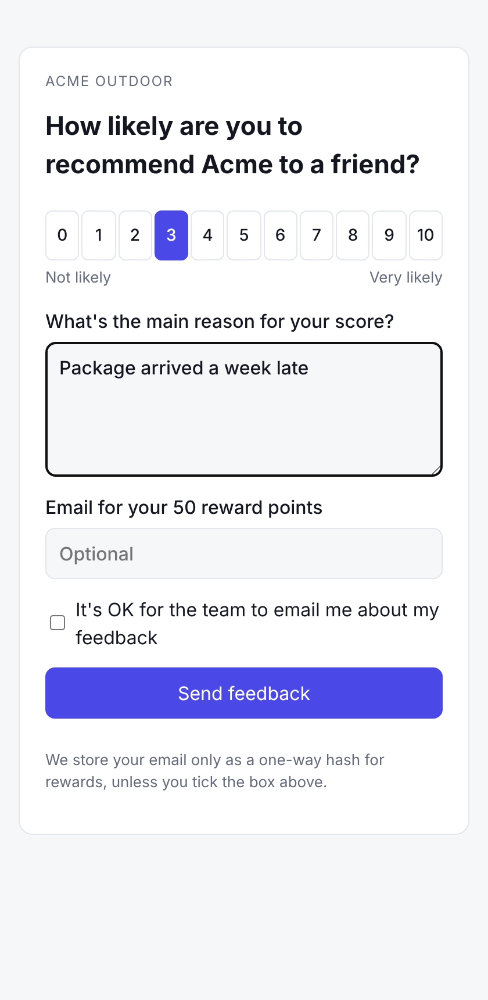
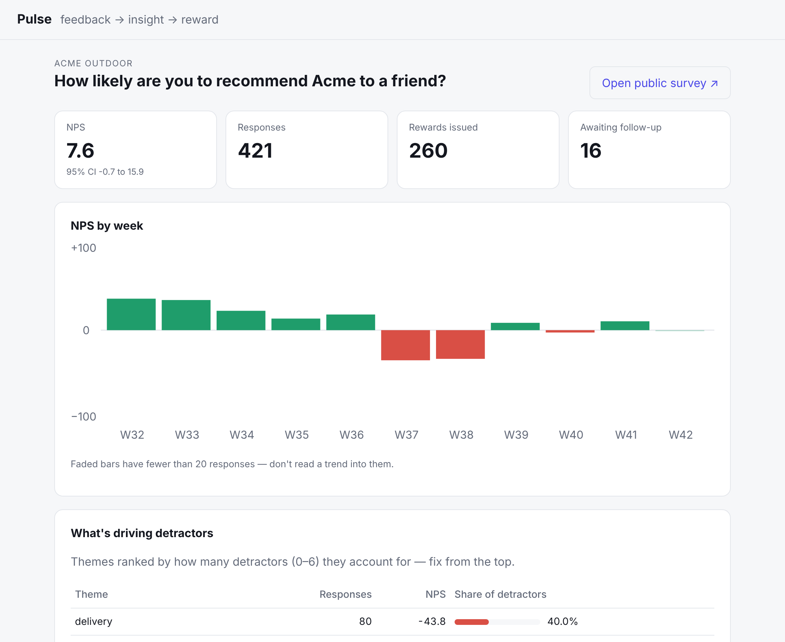

# Pulse — close the loop on customer feedback

[](https://github.com/lalithsagarkondapalli/pulse/actions/workflows/ci.yml)

A small, complete product for a brand that wants to know **why** customers would or wouldn't recommend it, **reward** them for saying so, and **follow up** with the unhappy ones before they churn.

```
customer answers a 0–10 question  →  gets reward points instantly
            │
            ▼
comment is PII-redacted and tagged by Claude (theme + sentiment), off the request path
            │
            ▼
brand dashboard: NPS with a confidence interval · weekly trend · which themes drive detractors
                 · a "close the loop" queue of detractors who agreed to be contacted
```

| Customer survey (mobile) | Brand dashboard |
|---|---|
|  |  |

> **Status:** working end to end on synthetic demo data, with tests and CI. It has not been used by real customers yet — see [What I'd measure after launch](#what-id-measure-after-launch).

## The problem

Most brands collect NPS and stop at the number. The number alone doesn't say what to fix, the free-text comments sit unread, and the customers who scored 2 never hear back. I scoped Pulse around three jobs:

1. **Make responding worth it** — a reward code on the thank-you screen, one per customer per survey.
2. **Turn comments into a ranked to-do list** — themes ordered by how many detractors they explain, not by volume.
3. **Make follow-up a queue, not a spreadsheet** — detractors who opted in, newest first, with a "mark done" action.

Everything else (multi-question surveys, email sending, integrations) was cut to ship those three well. The reasoning is in [DECISIONS.md](DECISIONS.md).

## Run it

```bash
python -m venv .venv && source .venv/bin/activate
pip install -r requirements.txt -r requirements-dev.txt
python -m scripts.seed                      # 10 weeks of synthetic responses, incl. a delivery incident
uvicorn app.main:app --reload
# brand dashboard: http://127.0.0.1:8000/dashboard/acme-outdoor-demo
# customer survey: http://127.0.0.1:8000/s/acme-outdoor-demo
pytest -q                                   # 22 tests
```

Claude tagging is optional. Without a key the app uses the rule baseline, so it always runs:

```bash
export ANTHROPIC_API_KEY=...  ANTHROPIC_MODEL=<a current Claude model id>
python -m scripts.eval_tagger               # accuracy on 40 hand-labelled comments, with every miss printed
```

Or with Docker: `docker build -t pulse . && docker run -p 8000:8000 -v pulse-data:/data pulse`.

## How it's built

| Layer | Choice | Why |
|---|---|---|
| API + pages | FastAPI, server-rendered Jinja, one CSS file, no JS framework | A survey must load instantly on a phone; the dashboard is read-mostly. |
| Data | SQLite via plain `sqlite3` ([`app/db.py`](app/db.py)) | Whole schema fits on one screen. Swap for Postgres when there are concurrent writers. |
| AI | [`app/themes.py`](app/themes.py): Claude with a fixed taxonomy and strict JSON, rule baseline as fallback | A fixed taxonomy keeps week-over-week trends comparable; free-form clustering would rename themes every run. |
| Metrics | [`app/metrics.py`](app/metrics.py): NPS with a 95% CI, ISO-week trend, detractor share per theme | A raw NPS on 25 responses is noise; the dashboard says so. |
| Rewards | [`app/rewards.py`](app/rewards.py): unique `(survey, customer)` constraint | A double-submit or retry can never mint two codes — enforced by the database, not by hope. |

### Customer data and safety

- Emails are stored as a SHA-256 hash (for reward de-duplication). The plain address is stored **only** if the customer ticks "OK to contact me", and only that list appears in the follow-up queue.
- Comments are redacted (emails, phone numbers, long digit runs) **before** they are sent to the model. A test asserts the prompt never contains them.
- The prompt treats the comment as data and the reply is validated against the taxonomy; anything else (including a prompt-injection attempt in the labelled set) falls back to the baseline instead of storing a bad label.
- Tagging runs as a background task, so the customer never waits on an LLM, and a model outage never loses a response.
- The JSON summary API omits contact details. Brand pages sit behind a token when `PULSE_ADMIN_TOKEN` is set. Survey pages have a honeypot field for bots.

## How AI was used to build it

Pulse was built AI-first with Claude as a pair programmer: scoping, code, tests and the demo data were drafted with AI, then checked rather than trusted.

- **Verified by behaviour, not by reading the diff.** 22 tests cover the full submit → reward → tag → dashboard path, consent handling, idempotent rewards, validation, auth, PII redaction, and 300 concurrent submissions.
- **Load-tested the obvious-looking code.** The first version shared one SQLite connection across FastAPI's thread pool. It passed every single-request test and crashed at 16 concurrent submitters. It now runs every statement under a lock with results fully fetched, and a regression test fires 300 parallel submissions and checks that exactly one reward is issued per customer.
- **Caught product bugs, not just code bugs.** Rendering real screenshots exposed two: score-only responses were landing in an "other" theme and dominating the detractor ranking, and a 1-response week drew a +100 bar that looked like a recovery. Both were fixed (score-only responses are excluded from theme ranking; weeks under 20 responses are faded with a note).
- **Measured the AI part.** `scripts/eval_tagger.py` scores a tagger on 40 hand-labelled comments, including a prompt-injection case and a comment containing a phone number. The rule baseline gets **68% theme / 98% sentiment** accuracy; its misses are mostly paraphrases ("showed up 9 days after the promised date"), which is exactly where an LLM should earn its cost. I didn't tune the keywords to the eval set, so the baseline number stays honest.

## What I'd measure after launch

| Question | Signal |
|---|---|
| Do rewards raise response rate without skewing scores? | Response rate and score distribution, reward vs no-reward surveys |
| Is the tagger good enough to act on? | Weekly sample of 50 tagged comments, human-checked; alert if agreement drops below 80% |
| Does close-the-loop work? | Share of detractors contacted within 48h; their score on the next survey |
| Are themes stable? | Share of comments landing in `other` — if it climbs, the taxonomy needs a new theme |

## Known limitations

- Single admin token, not per-user accounts. No rate limiting beyond the honeypot.
- One question per survey. No email delivery — the follow-up queue shows who to contact, it doesn't send.
- SQLite is fine for one process; multiple workers need Postgres.
- Demo data is synthetic (`scripts/seed.py`); no real customer data is in this repo.
